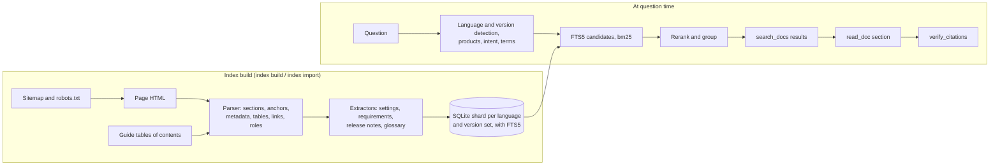

# Tenable Docs MCP

A [Model Context Protocol](https://modelcontextprotocol.io) server that answers questions from Tenable's product documentation, with a link to the exact section that supports each answer. It covers [docs.tenable.com](https://docs.tenable.com) and its seven translated sites, in every product, guide, and published version, and it runs locally as a single Go binary with an embedded SQLite index.

> **Status: in progress toward 1.0.** The tools, prompts, resources, and completions described here work, and the server downloads the prebuilt index from docs.tenable.com on first run and keeps it up to date. There are no release binaries yet; build from source with Go 1.26 or later. Building the index from the live sites, for when the prebuilt index can't be reached, is planned for 1.0 and doesn't exist today. Where this README describes 1.0 behavior, it says so.

For questions about Tenable's APIs, use the [Tenable Developer Portal MCP](https://developer.tenable.com/mcp), which developer.tenable.com hosts. The two are complementary: this server covers the product documentation, and that one covers the API reference.

## Contents

- [Why it exists](#why-it-exists)
- [Features](#features)
- [Install](#install)
- [Connect it to an MCP client](#connect-it-to-an-mcp-client)
- [Tools](#tools)
- [Prompts, resources, and completions](#prompts-resources-and-completions)
- [How a question becomes a cited answer](#how-a-question-becomes-a-cited-answer)
- [The index and snapshot format](#the-index-and-snapshot-format)
- [Command line](#command-line)
- [Privacy and security](#privacy-and-security)
- [Search quality](#search-quality)
- [Development](#development)
- [License](#license)
- [Disclaimer](#disclaimer)

## Why it exists

Tenable's documentation is large (about 21,200 pages across eight sites), versioned per product, partly translated, and structured in ways a generic web search ignores: settings tables, requirements tables, required-role statements, release-note entries, and per-guide tables of contents.

Tenable Docs MCP indexes that structure and exposes it through MCP tools, so an assistant can:

- find the section that answers a question, in the right product, version, and language;
- read it as Markdown, with its place in the guide and the roles it requires;
- answer narrow questions (a setting's default, a port, a required role) from the tables the docs already contain;
- cite a stable link to the heading, and check every link before sending the answer;
- say plainly when the docs don't cover something.

## Features

- **Eight sites, one index.** English, Japanese, Simplified Chinese, Traditional Chinese, Korean, French, German, and Spanish, each with current and older-version guides.
- **Language-aware full-text search.** SQLite FTS5 with a tokenizer per language: Porter stemming for English, diacritic folding for French, German, and Spanish, and trigrams for Japanese, Chinese, and Korean.
- **Question understanding.** Recognizes 22 products by current, retired, and short names (Tenable.io, Tenable.sc, Tenable.ad, NNM, PVS, and others), product versions ("Security Center 6.3"), quoted phrases, and the kind of question: how-to, what's new, or requirements.
- **Version and language fallback.** Searches the version a question names, falls back to its major and minor version, then to the current version, and says so. Falls back to English when a translated site has nothing for the question, and says so.
- **Section-level citations.** Pages are split at their headings, and every section carries the URL of its anchor. Translations and older versions also return the current English page with the same anchor.
- **Structured answers.** Dedicated tools read settings tables, requirements tables, required-role statements, release-note entries, and glossaries.
- **Citation checking.** `verify_citations` (and the `verify-links` command) checks every docs link in an answer or a draft: the page exists, the anchor is on it, and whether the link points to an older version or a translation.
- **Honest gaps.** When the docs don't answer a question, `report_gap` records it locally and, if the user chooses, sends it to Tenable's documentation team through a form the user approves.
- **Local and private.** No telemetry. The only routine network access is downloading the prebuilt index and checking it for updates once a day, which can be turned off. See [Privacy and security](#privacy-and-security).
- **Single static binary.** Pure Go, including the SQLite driver ([modernc.org/sqlite](https://pkg.go.dev/modernc.org/sqlite)), so it builds with `CGO_ENABLED=0` for Linux, macOS, and Windows on amd64 and arm64.

## Install

Until 1.0 ships release binaries, build from source with Go 1.26 or later:

```bash
git clone https://github.com/lanz/tenable-docs-mcp
cd tenable-docs-mcp
go build ./cmd/tenable-docs-mcp
./tenable-docs-mcp version
```

Or install it into `$(go env GOPATH)/bin`:

```bash
go install github.com/lanz/tenable-docs-mcp/cmd/tenable-docs-mcp@latest
```

A build from a Git clone reports a version from its commit, such as `v0.0.0-20261107200239-5f52e6e8e77f`; `go install …@vX.Y.Z` reports the release.

### Getting an index

There's nothing to set up. The first time the server starts, it downloads the prebuilt index snapshot from `https://docs.tenable.com/mcp/index/v1/` in the background and builds the local index from it: about 21,200 pages in 13 shards, 12 MB to download, and a local index of about 380 MB, in under a minute. Until it's done, `index_status` reports `downloading`, and the search and reading tools say the index is downloading.

After that, the server checks for an update once a day. Only shards whose files changed are downloaded and rebuilt, and each is swapped in whole, so searches keep working during an update. A failed check is retried an hour later, or after five minutes while the index is still empty. `index_status` shows when the index was last checked, when the snapshot was built, and the last error, if any.

To download or update the index without starting the server, run `tenable-docs-mcp index pull`. Other ways to build it:

- `tenable-docs-mcp index import SNAPSHOT` builds the index from a snapshot folder on disk.
- `tenable-docs-mcp index build -source …` builds from local copies of the sites' published files, one folder per site. Most users won't have these.

Two environment variables change the downloads:

| Variable | Effect |
| --- | --- |
| `TDM_INDEX_URL` | `off` turns automatic downloads and updates off. Any other value is the `https://` address of a snapshot folder to use instead of the one on docs.tenable.com. |
| `TDM_SITES` | Only download these sites, such as `en,jp` (default: all eight). `index pull -sites` does the same for one run. |

## Connect it to an MCP client

The server speaks MCP over stdio by default, so a client runs it as a command with no arguments. Use the binary's full path. On Windows, use forward slashes in shell commands and doubled backslashes in JSON (`"C:\\tools\\tenable-docs-mcp.exe"`).

### Claude Code

```bash
claude mcp add --scope user tenable-docs -- /path/to/tenable-docs-mcp
```

Prompts appear as slash commands, such as `/mcp__tenable-docs__how-to`.

### Claude Desktop

In `claude_desktop_config.json` (Settings > Developer > Edit Config):

```json
{
  "mcpServers": {
    "tenable-docs": {
      "command": "/path/to/tenable-docs-mcp"
    }
  }
}
```

### VS Code

In `.vscode/mcp.json` for a workspace, or in your user `mcp.json`:

```json
{
  "servers": {
    "tenable-docs": {
      "type": "stdio",
      "command": "/path/to/tenable-docs-mcp"
    }
  }
}
```

### Cursor

In `~/.cursor/mcp.json`, use the same `mcpServers` entry as Claude Desktop.

### Other clients

Any MCP client that launches stdio servers works the same way. Over stdio, standard output carries only protocol messages, and diagnostics go to standard error.

To use an index somewhere other than the default folder, pass it as arguments, or set `TDM_INDEX_DIR` in the server's environment. `TDM_INDEX_URL` and `TDM_SITES` (see [Getting an index](#getting-an-index)) go in the same `env` block:

```json
{
  "mcpServers": {
    "tenable-docs": {
      "command": "/path/to/tenable-docs-mcp",
      "args": ["serve", "-index", "/path/to/index"]
    }
  }
}
```

### Streamable HTTP

For a client on the same machine that prefers HTTP:

```bash
tenable-docs-mcp serve -http 127.0.0.1:8080
```

The server listens at `http://127.0.0.1:8080/mcp`, with a health check at `/healthz`. It accepts only loopback addresses (`127.0.0.1`, `::1`, or `localhost`) and refuses to start on any other; see [HTTP server hardening](#http-server-hardening). In Claude Code, for example:

```bash
claude mcp add --transport http tenable-docs http://127.0.0.1:8080/mcp
```

## Tools

The server registers 16 tools. Each returns structured output (with a JSON schema) and a short text summary for the assistant. The search and reading tools are annotated read-only, idempotent, and closed-world: they read only the local index.

### Search and read

| Tool | What it does | Main inputs |
| --- | --- | --- |
| `search_docs` | Ranked sections that answer a question, each with its link, a snippet with matched words marked `«like this»`, product, guide type, version, language, location, last-modified date, and required roles. Also returns same-titled pages in other products (`also_in`), spelling suggestions when nothing matches, and the products that do match when a product filter excluded everything. | `query`, plus optional `product`, `guide_type`, `guide`, `version`, `language`, `release_notes`, `required_role`, and `limit` (1 to 25, default 8) |
| `read_doc` | A section (link with `#anchor`) or a whole page (link without one) as Markdown, starting with a header that gives its location, product, version, required roles, source URL, and update date. Long content comes in parts. Returns the previous and next sections, and the page in other languages and versions. | `url`, `part`, and `max_chars` (1,000 to 30,000, default 8,000) |
| `outline` | A page's headings with links and word counts, or a guide's pages from its table of contents. | `url` or `guide`, and `language` |
| `browse_guide` | A guide's table of contents in reading order, with depths, links, and counts of entries below the depth shown. | `guide` (a path such as `nessus/10_8`, or any page's URL), `language`, and `depth` (1 to 10, default 3) |
| `related_pages` | A page's parent, previous, and next entries in its table of contents; the docs pages it links to and that link to it; same-titled pages in other products; and the page in other languages and versions. | `url` |
| `list_products` | Every product and language in the index, with page counts, each product's English guides and their older versions, and when each language was last indexed. | none |

### Specific questions

| Tool | What it does | Main inputs |
| --- | --- | --- |
| `find_setting` | A setting's description, default, valid values, and whether it's required, from the docs' settings tables. Rows that give a default rank higher. | `query`, `product`, `version`, and `limit` (1 to 20, default 5) |
| `required_role` | The roles and permissions the docs say a task needs, by page. When no matching page states a role, it says so and lists the closest pages. | `task`, `product`, `version`, and `language` |
| `requirements` | Rows from requirements tables: `ports`, `hardware`, `operating-systems`, `browsers`, `dependencies`, or `other`. Infers the kind and product from a question such as "Security Center hardware for 10,000 hosts". | `product`, `kind`, `query`, `version`, and `limit` (1 to 100, default 30) |
| `release_notes` | Release-note entries, newest first, filtered by product, date range, version (10.8 matches 10.8.1), and words. | `product`, `since`, `until` (`YYYY`, `YYYY-MM`, or `YYYY-MM-DD`), `version`, `query`, `language`, `full`, and `limit` (1 to 50, default 10) |
| `define_term` | Glossary definitions (abbreviations also match by initials, so NVD finds National Vulnerability Database), and what a product name refers to, including retired names. | `term` and `language` |

`find_setting` and `requirements` read English pages, because they recognize tables by their English column headings. For a question in another language, they say so in their notes.

### Citations, gaps, feedback, and the index

| Tool | What it does | Network |
| --- | --- | --- |
| `verify_citations` | Checks every docs link in an answer or draft (Markdown, HTML, or plain text, up to 200,000 characters). See [Citations and verify_citations](#citations-and-verify_citations). | Only with `check_live` |
| `report_gap` | Records a question the docs didn't answer in a local file only the user can read. If the client can show forms, it then offers the user a form to send the question to Tenable's documentation team. | Only if the user accepts the form |
| `open_feedback_form` | Shows the user a feedback form for a docs page. The assistant chooses only the page and whether the user found it helpful; the user writes the comment, and there's no argument for one. | Only if the user accepts the form |
| `index_status` | The server's version, Go version, index folder, and each shard's pages, sections, schema version, build time, and last-indexed time; and the automatic updates: where they come from, the last check, when the snapshot was built, any update in progress, and the last error. | No |
| `refresh_index` | Updates given pages (up to 500), or every page of a guide and its table of contents, from the live sites. Reports checked, updated, unchanged, removed, and skipped pages, with progress notifications when the client asks for them. | Yes |

## Prompts, resources, and completions

### Prompts

Each prompt expands into instructions that name the tools to use and end with the same rules: cite the links used, check them with `verify_citations`, state the product and version, and say when the docs don't cover something.

| Prompt | Use it to | Arguments (required in bold) |
| --- | --- | --- |
| `how-to` | Get the docs' steps for a task, with the role it needs and what to do first | **`task`**, `product`, `version`, `guide_type`, `language` |
| `explain-setting` | Explain a setting: what it does, its options and default, where it is, and when to change it | **`setting`**, `product`, `version`, `language` |
| `troubleshoot` | Find likely causes and fixes for a problem or error message, including known issues in release notes | **`problem`**, `product`, `version`, `language` |
| `whats-new` | Summarize a release: features, changes, fixes, known issues, and removals | **`product`**, `version`, `language` |
| `who-can` | Find the role or permissions an action needs | **`action`**, `product`, `version`, `language` |
| `upgrade-check` | List what changes between two versions: requirements, deprecations, defaults, upgrade paths, and known issues | **`product`**, **`from_version`**, `to_version`, `language` |
| `fact-check` | Check a reply or draft against the docs: what's right, wrong, out of date, or unsupported | **`text`**, `question` |

### Resources

| URI | Content |
| --- | --- |
| `tenable-docs://status` | The index status as JSON, as `index_status` reports it |
| `tenable-docs://page/{+doc_id}` | A whole page as Markdown, where `doc_id` is its URL without `https://`, such as `docs.tenable.com/nessus/Content/GettingStarted.htm` |
| `tenable-docs://guide/{+guide}/toc{?language}` | A guide's table of contents as a nested Markdown list of links, such as `tenable-docs://guide/security-center/6_8/toc` |

When the index has English pages at startup, the server also lists one `toc/<guide>` resource for each current English guide, so clients can offer them in a picker.

### Completions

The server implements MCP completion for prompt arguments and resource template variables:

| Argument | Completes to |
| --- | --- |
| `product` | Product names |
| `language` | Site codes: `en`, `jp`, `zh-cn`, `zh-tw`, `kr`, `fr`, `de`, `es` |
| `guide` | Guide paths in the given language, current guides first, then older versions |
| `guide_type` | Guide types in the English index, such as User Guide and Release Notes |
| `version`, `from_version`, `to_version` | Older versions in the index, newest first, narrowed to the given guide or product |

Values that start with the typed text come first, then values that contain it, up to 100.

## How a question becomes a cited answer



### Parsing pages

A build reads each site's `robots.txt` and `Sitemap.xml`, skips entries that `robots.txt` disallows or that aren't HTML pages (PDFs, for example), and parses the rest:

- **Content.** The page's main content element is rendered to Markdown: headings, lists, tables, code blocks, and links. Notes, tips, cautions, and warnings become block quotes; drop-downs are expanded; inline popups appear in parentheses; icons become their names in brackets, as the text reads them ("select the [more] button"). Navigation, scripts, buttons, and other page chrome are left out. Nesting deeper than 200 elements is read as plain text, so hostile input can't exhaust the stack.
- **Sections and anchors.** A page is split at its level-2 headings (including paragraphs styled as headings, which many translated pages use). A section larger than 6,000 bytes is split again at its level-3 headings. Each section keeps its heading's anchor, its URL (`page.htm#anchor`), and the trail of headings above it.
- **Metadata.** Title, description, and language come from the page; product, product version, and guide type from its meta tags; products and guide type also from the sitemap, which is the fuller source. A page listing more than three products (a glossary, say) gets no single product. Tenable Core pages belong to Tenable Core, with the product the appliance runs as a related product.
- **Guides and versions.** A page's guide is the part of its path before `/Content/`. A path segment such as `10_8` marks an older version (10.8); those pages go into the language's older-version shard. Each guide's table of contents is read once per build and gives every page its place ("location") in the guide.
- **Required roles.** Statements such as "Required User Role: Administrator or Custom Role" are kept as label and text, and on English pages the roles are split into a list.

### Extracting structured data

| Extractor | How it recognizes its data |
| --- | --- |
| Settings | Tables whose first column names options, settings, parameters, fields, arguments, flags, variables, properties, attributes, preferences, or keys, with a description or default column. Default, valid values, and required columns are read by their headings; other columns are kept as labeled fields. |
| Requirements | Tables classified by their column headings as ports, hardware, operating systems, browsers, or dependencies, plus other tables in sections about requirements, prerequisites, support, or compatibility. Message and error-code tables are excluded. |
| Release notes | Pages in the release notes guide, split into entries at level-2 headings that carry a date or version number. Dates are read in English, French, German, and Spanish month formats, ISO dates, and Japanese, Chinese, and Korean year-month-day formats. |
| Glossary | Glossary entries with their anchors, and two-column tables of terms (or acronyms) and definitions. |
| Links | Links to other docs pages, without fragments, for `related_pages`. |

### The per-language full-text indexes

Each shard is one SQLite database with FTS5 virtual tables over its sections and settings. The tokenizer depends on the site's language:

| Sites | FTS5 tokenizer | Why |
| --- | --- | --- |
| `en` | `porter unicode61 remove_diacritics 2` | Stemming matches "configure", "configuring", and "configured" |
| `fr`, `de`, `es` | `unicode61 remove_diacritics 2` | Accent-insensitive word matching |
| `jp`, `zh-cn`, `zh-tw`, `kr` | `trigram remove_diacritics 1` | No spaces between words, so match on character trigrams |

A section is indexed with four columns, weighted for bm25: page title (10), section heading (6), location in the guide (3), and body (1). Japanese, Chinese, and Korean words of two characters are too short for trigrams; they're matched as substrings alongside the full-text query.

### Reading the question

Before searching, the question is parsed:

- **Language.** The `language` argument wins. Otherwise kana means Japanese, Hangul means Korean, and Chinese characters alone mean Simplified or Traditional Chinese, decided by characters that differ between the scripts. Latin-script questions are French, German, or Spanish when those languages' common words and accents outnumber English ones; anything else is English.
- **Products.** Product names and aliases are matched longest first ("Nessus Network Monitor" before "Nessus"), so "Tenable.sc", "tsc", and "Security Center" all mean Security Center. Short aliases that are also ordinary words, such as `SC` and `WAS`, match only in capitals.
- **Version.** A version such as `6.3` or `10.8.1` is taken when it's next to a product name or written as "version 6.3" or "v6.3", and not when it's part of a longer dotted number such as an IP address.
- **Intent.** Patterns in English and in the translated sites' languages mark a question as what's new, requirements, or how-to, and note whether it's about installing.
- **Terms.** Quoted phrases are searched as written. Filler words are dropped in English, French, German, and Spanish; product names and the version are removed from the terms; and split compounds are joined ("back up" becomes "backup", "log in" becomes "login"). Japanese and Chinese text is split at function words and, for Japanese, at changes between katakana, hiragana, and kanji; Korean words lose their particles.

### Ranking

1. **Candidates.** The shard returns up to 120 sections that contain every term, ranked by bm25 with the column weights above. When few sections have every word (fewer than 30 for a question of three or more words), sections that miss one word are added at a penalty, so one stray word ("open", "need") doesn't hide the answer. When nothing matches, any of the words will do, and the result is marked `relaxed`.
2. **Rerank.** Each candidate's score is multiplied by boosts:

   | Signal | Factor |
   | --- | --- |
   | The page's product is one the question names | 1.8 |
   | A related product is one the question names | 1.25 |
   | The question names the page's guide (Director, Enterprise Manager) | 1.6 |
   | Share of the question's words in the page title | up to 1.8 |
   | The title is the question's words, give or take two | 1.3 |
   | How-to question, on a user guide | 1.3 |
   | How-to question, on release notes, studies, or white papers | 0.7 |
   | What's-new question, on release notes | 2.2 (0.75 otherwise) |
   | What's-new question, on the newest year's release notes | 1.6 (0.8 for older years) |
   | Requirements question, on a page with requirements tables | 1.7, and 1.3 more if the title says requirements |
   | Install question (not already a requirements question), on a page with requirements tables | 1.15 |
   | Section missing one of the question's words | 0.6 |

3. **Group.** At most two sections per page are kept. Pages with the same title in another product or guide are folded into the first one's `also_in` list rather than filling the results.
4. **No results.** The response suggests respellings (the closest indexed words within one or two edits, from a vocabulary of words seen at least twice) and lists the products that do match when a product filter excluded everything.

### Versions and languages

- A question that names a version searches the language's older-version shard for that exact version, then for its major and minor version (6.3.1 finds 6.3), then the current docs, with a note saying it fell back. A what's-new question turns the version into a search term instead, because release notes aren't split into versioned guides.
- When a translated site has nothing for the question, or has matches only for products other than the one named, the search runs again on the English site and notes that the results are in English. Chinese questions without an explicit language also try the other Chinese script and Japanese first.
- Every result lists the same page in other languages and versions. For a translation or an older version, `english_url` is the current English page with the same anchor, which is the link to cite.

### Citations and verify_citations

`verify_citations` and `tenable-docs-mcp verify-links` share one checker. It finds Markdown links, `href` attributes, and bare docs URLs (with or without `https://`), resolves relative links against `base_url` when one is given, and counts links to other sites, files, and unresolved relative links as skipped. Each docs link gets a status:

| Status | Meaning | Broken |
| --- | --- | --- |
| `ok` | The page is in the index, and its anchor is one of the page's headings | No |
| `older_version` | The page is for an older version; `current_url` is the current one | No |
| `translation` | The page is a translation; `english_url` is the current English page | No |
| `anchor_unknown` | The anchor isn't a heading; it may be on a smaller element | No |
| `anchor_missing` | A live check found no element with that `id` or `name` | Yes |
| `moved` | A live check found that the site redirects the link | No |
| `not_found` | The page isn't in the index, or, with a live check, on the site | Yes |
| `not_indexed` | The index has no docs for that language or version set | No |

For a broken link, the checker suggests the current or English version of the page when the index has it, or else the best search result for the words of the file name (`InstallNessusLinux.htm` becomes "Install Nessus Linux"). With `check_live` (or `-live`), it fetches the live page to settle anchors that aren't headings and pages the index doesn't have yet.

For documentation writers, `verify-links` also checks draft topics: `-base` gives the draft's published URL, and a broken relative link whose target file exists beside the draft is noted as a topic in the source project that isn't published.

### Refreshing pages

`refresh_index` updates pages the index already has. It honors `robots.txt`, sends conditional requests (`If-None-Match` and `If-Modified-Since`) so unchanged pages cost a `304`, rewrites a page only when its content hash changes, and removes pages the site no longer publishes. Refreshing a guide also fetches its table of contents again. New pages arrive with a full index update.

## The index and snapshot format

### Shards

The index is a folder of SQLite databases, one per site and version set:

```text
en-current.4.db    en-older.4.db
jp-current.4.db    jp-older.4.db
...
es-current.4.db
snapshot/          updates.json
```

Each time a shard is rebuilt, the new build gets the next number, and the server switches to it. More than one MCP client can run the server on the same folder, so no process replaces a file another one has open (which Windows doesn't allow). The others switch to the new build within a minute, and older builds are deleted once nothing has them open. An index written before builds were numbered has `en-current.db` and so on, and it opens as it is. Only one process updates a folder at a time; it holds `update.lock` while it does.

`snapshot/` holds the downloaded snapshot files and their manifest, so a shard can be rebuilt without downloading it again. `updates.json` records the last update check, so every process using the folder knows when the next one is due. Each shard records the checksum of the snapshot file it was built from, which is how an update tells which shards changed.

A shard is created only when there are pages for it; a full build has 13. Each shard records its key and tokenizer in a `meta` table and its schema version in `PRAGMA user_version` (currently 2). Opening a shard written by a newer build, or a file that holds a different shard or tokenizer, fails with an error instead of returning wrong results. Shards run in WAL mode.

| Table | Holds |
| --- | --- |
| `pages` | One row per page: URL, site, language, title, description, product, related products, guide, guide type, version, current-version URL, table-of-contents trail, required roles, dates, HTTP validators, and a content hash |
| `sections`, `sections_fts` | Sections with their anchors, URLs, locations, and Markdown, and the full-text index over them |
| `settings`, `settings_fts` | Settings table rows, and the full-text index over their names, descriptions, and context |
| `requirements` | Requirements table rows, by kind |
| `releases` | Release-note entries with product, version, and date |
| `glossary` | Terms and definitions |
| `links` | Links between pages |
| `tocs` | Each guide's table of contents, as JSON |
| `vocabulary` | Indexed words and their frequencies, for spelling suggestions |
| `changes` | Pages added, updated, or removed by each build |

Builds and imports never write to a live shard. Each shard is built beside it as `<key>.building.db`, in transactions of 500 pages, then optimized (vocabulary rebuilt, FTS segments merged, `PRAGMA optimize`) and swapped in under a write lock, so searches keep working throughout. Importing some sites (`-sites en,jp`) replaces only their shards.

### Snapshots

A snapshot holds the parsed pages and tables of contents of each shard, so importing one doesn't parse HTML. It's a folder:

```text
manifest.json
en-current-3f2a9c1b0d4e.jsonl.zst
en-older-8b41d07ce2a5.jsonl.zst
jp-current-c09e5f7a1b38.jsonl.zst
...
```

Each shard file is zstd-compressed JSON Lines. Every line is either a guide's table of contents (`{"toc": …}`) or a parsed page with its sitemap entry and table-of-contents trail (`{"page": …}`). A file is named for its shard and the first 12 hexadecimal digits of its SHA-256 checksum, so a new snapshot never overwrites an old one's files. Publishing uploads the shard files first and the manifest last; a client that reads the old manifest in the meantime still finds its files.

The manifest lists every shard:

```json
{
  "format": 1,
  "built_at": "2026-11-01T06:00:00Z",
  "generator": "tenable-docs-mcp v1.0.0",
  "shards": [
    {
      "key": "en-current",
      "site": "en",
      "older": false,
      "file": "en-current-3f2a9c1b0d4e.jsonl.zst",
      "size": 4718592,
      "sha256": "3f2a9c1b0d4e5f60718293a4b5c6d7e8f90a1b2c3d4e5f60718293a4b5c6d7e8",
      "pages": 9120,
      "tocs": 212
    }
  ]
}
```

(The values above are illustrative.)

Before importing, `index import` and `index pull` check that the manifest's format is one it reads, that each shard's site is known, and that each file name matches its key and checksum. It then verifies each file's size and SHA-256 before decompressing it, caps decompression memory at 512 MiB, checks that every page belongs to the shard it's in, and checks the page count against the manifest. `index verify` runs the size and checksum checks alone.

## Command line

| Command | What it does |
| --- | --- |
| `tenable-docs-mcp` | Serve MCP over stdio (what clients run) |
| `tenable-docs-mcp serve [-http ADDR] [-index DIR]` | Serve over stdio, or over streamable HTTP on a loopback `ADDR`, from the index in `DIR` |
| `tenable-docs-mcp verify-links [-base URL] [-live] [-json] [-index DIR] FILE...` | Check the docs links in answers or drafts (`-` reads standard input) |
| `tenable-docs-mcp gaps export [-since YYYY-MM-DD] [-json] [-file FILE]` | Summarize the recorded questions, grouped by product, as Markdown or JSON |
| `tenable-docs-mcp gaps clear -yes [-file FILE]` | Delete the recorded questions |
| `tenable-docs-mcp gaps path` | Print where the questions are recorded |
| `tenable-docs-mcp index pull [-sites en,jp] [-index DIR]` | Download the prebuilt index, or update it; only shards that changed are downloaded and rebuilt |
| `tenable-docs-mcp index import [-sites en,jp] [-index DIR] SNAPSHOT` | Verify a snapshot folder and build the index from it |
| `tenable-docs-mcp index verify SNAPSHOT` | Check a snapshot's files against its manifest |
| `tenable-docs-mcp index build -source SITES [-sites en,jp] [-out DIR \| -index DIR] [-json]` | Build a snapshot (`-out`) or an index (`-index`) from local copies of the sites |
| `tenable-docs-mcp version` | Print the version |
| `tenable-docs-mcp help` | Show usage |

`-source` takes `code=folder` pairs separated by semicolons, such as `"en=/data/en;jp=/data/jp"`, on every platform. On Linux and macOS, colons work too. `TDM_SITE_DIRS` uses the same format.

The index folder is, in order: the `-index` flag, `$TDM_INDEX_DIR`, or `tenable-docs-mcp/index` in the user cache folder.

`verify-links` exits with 1 when any link is broken, and with 2 on a usage or input error. `index build` exits with 1 when any page fails. `index pull` exits with 1 when the download or the build fails, leaving the index as it was.

## Privacy and security

### No telemetry

The server never reports how it's used. Downloading the prebuilt index and checking it for updates once a day are its only routine requests: they send nothing but the user agent and, so the CDN doesn't serve a stale manifest, the current time as a query string. `TDM_INDEX_URL=off` turns them off. Every other request comes from a feature in the next table.

### Hosts it connects to

| Host | When | Why |
| --- | --- | --- |
| `docs.tenable.com` | When the server starts with an empty index, once a day after that, and `index pull` | Download the prebuilt index from `/mcp/index/v1/`: the manifest, then only the shard files that changed |
| `docs.tenable.com`, `jp.docs.tenable.com`, `zh-cn.docs.tenable.com`, `zh-tw.docs.tenable.com`, `kr.docs.tenable.com`, `fr.docs.tenable.com`, `de.docs.tenable.com`, `es.docs.tenable.com` | `refresh_index`; `verify_citations` with `check_live`; `verify-links -live` | Fetch pages, tables of contents, and `robots.txt` |
| `www.tenable.com` | Only when the user accepts a feedback or gap form | Send the feedback, through the same endpoint the feedback form on each docs page uses |

Every other host is refused, including redirects to other hosts and redirects from HTTPS to HTTP. Requests use the system's certificate store and honor `HTTPS_PROXY`, and identify themselves as `tenable-docs-mcp/<version> (+https://github.com/lanz/tenable-docs-mcp)`.

### Limits on traffic to the docs sites

- At most 4 requests in flight and 5 started per second.
- Index downloads: one update check a day, one file at a time, and only the files that changed.
- `robots.txt` rules for the `tenable-docs-mcp` token (or `*`), following RFC 9309.
- Conditional requests for pages already in the index.
- Up to 3 retries on rate limits, server errors, and network errors, honoring `Retry-After` up to 60 seconds and otherwise backing off exponentially to at most 30 seconds.
- A 60-second timeout per attempt, a 32 MiB limit per document, and at most 10 redirects.

### What it sends to Tenable

Only feedback or a gap report that the user writes, or approves, in a form their MCP client shows them. Nothing is sent without that. The assistant can't write the user's feedback: `open_feedback_form` has no argument for a comment, and the gap form pre-fills the question for the user to edit. Forms expire after 30 minutes and are bound to the page they were opened for. Sending is limited to one item a minute and ten a day, across every session on the computer. For clients that can't show forms, sending is off, and the tools tell the assistant to give the user the page's link instead.

### What it stores, on this computer

| Data | Location | Permissions |
| --- | --- | --- |
| The index, with the downloaded snapshot in its `snapshot` folder | `tenable-docs-mcp/index` in the user cache folder (`~/.cache` on Linux, `~/Library/Caches` on macOS, `%LocalAppData%` on Windows), or `$TDM_INDEX_DIR` | Folders `0700`, new files `0600` |
| Questions recorded with `report_gap` | `tenable-docs-mcp/gaps.jsonl` in the user settings folder (`~/.config` on Linux, `~/Library/Application Support` on macOS, `%AppData%` on Windows) | Folder `0700`, file `0600` |
| A log of feedback sent, which also counts the rate limits | `tenable-docs-mcp/feedback.jsonl` in the user settings folder | Folder `0700`, file `0600` |

On Windows, permission bits don't apply; those folders are already private to the user. A recorded gap holds the question, product, language, the assistant's note on what it searched, the server version, and the time. The note stays on this computer. `tenable-docs-mcp gaps clear -yes` deletes the file.

### HTTP server hardening

The optional HTTP transport is for clients on the same machine:

- It listens only on loopback addresses and refuses to start on any other.
- Requests whose `Host` header isn't a loopback name are rejected, which blocks DNS rebinding.
- Cross-origin browser requests are refused, so a web page can't drive a local server.
- It sets a 10-second header read timeout, a 2-minute idle timeout, and a 64 KiB header limit. There's no write timeout, because streamed responses can stay open.

### Input handling

User text reaches SQLite only as bound parameters, and every word in a full-text query is quoted, so FTS5 syntax in a question is read as text. The page parser, query parser, search, and table-of-contents parser have fuzz tests. Tests can't send feedback to Tenable: the sender refuses any `tenable.com` endpoint when running under `go test`.

## Search quality

Search quality is measured with evaluation sets in [`internal/search/testdata`](internal/search/testdata). Each case is a question and the pages that answer it. A test runs every question through the search engine and reports recall at 5 (how often an expected page is in the top five) and mean reciprocal rank (MRR, 1 for a first-place answer, 1/2 for second, and so on, up to tenth).

| Set | Questions | Recall@5 | MRR | Test threshold |
| --- | ---: | ---: | ---: | --- |
| English (`eval-en`) | 36 | 0.97 | 0.90 | 0.80 / 0.60 |
| English holdout (`eval-en-holdout`) | 16 | 0.88 | 0.80 | 0.80 / 0.60 |
| Older versions (`eval-versions`) | 12 | 0.92 | 0.87 | 0.80 / 0.60 |
| Japanese (`eval-ja`) | 14 | 1.00 | 0.75 | 0.70 / 0.50 |
| French (`eval-fr`) | 10 | 0.90 | 0.90 | 0.70 / 0.50 |

Scores are from a full index. Ranking was tuned on `eval-en`. The holdout set was written separately and not tuned on, so it shows how well the tuning generalizes. The French set includes a question that only the English docs answer, which tests the fallback.

The specialized tools have their own sets in [`internal/tools/testdata`](internal/tools/testdata), which require the right page among each tool's first five for at least 90% of questions. An end-to-end test builds the binary, runs it over stdio as a client would, answers every evaluation question with `search_docs` and then `read_doc`, and checks that each answer comes with a citation `read_doc` can open.

## Development

```bash
go build ./...
go vet ./...
go test ./...
go test -race ./...    # needs cgo
```

CI runs `go vet` and the tests on Linux, macOS, and Windows with the latest stable Go, and on Linux with the minimum version in `go.mod` (with the race detector everywhere but Windows), plus `gofmt`, `go mod tidy -diff`, [staticcheck](https://staticcheck.dev), [govulncheck](https://go.dev/doc/security/vuln/), and a cross-platform release build (`scripts/build-release.sh`).

Fuzz targets: `FuzzParse` (`internal/page`), `FuzzParseLang` and `FuzzSearch` (`internal/search`), and `FuzzParseDefine` (`internal/site`):

```bash
go test -run '^$' -fuzz FuzzParse ./internal/page
```

### Opt-in tests

Tests that need a real index, local copies of the sites, or the live sites are skipped unless their environment variables are set:

| Variable | Enables |
| --- | --- |
| `TDM_INDEX_DIR` | The search and tool evaluations and the end-to-end test, against the index in that folder |
| `TDM_SITE_DIRS` | Builds from local copies of the sites (`en=DIR;jp=DIR`); the search evaluation builds the shards it needs, into `TDM_INDEX_DIR` when that's set |
| `TDM_LIVE=1` | Checks against the live docs sites, such as comparing parsing and extraction of live pages with local copies |
| `TDM_BUILD_SITE` | The language the local build test builds (default `en`) |
| `TDM_SAMPLES` | How many extracted rows the extraction check logs (default 3) |
| `TDM_SHOW` | Logs each tool's full text answer in the tool evaluation |

For example:

```bash
TDM_INDEX_DIR=/path/to/index go test -run 'TestEval|TestEndToEnd' -v ./internal/search ./internal/tools ./cmd/tenable-docs-mcp
```

### Layout

| Package | Responsibility |
| --- | --- |
| `cmd/tenable-docs-mcp` | Commands and flags |
| `internal/server` | MCP server setup, instructions, and the HTTP transport |
| `internal/tools` | Tools, prompts, resources, and completions |
| `internal/search` | Question parsing, language detection, product names, ranking, and spelling suggestions |
| `internal/index` | SQLite shards, schema, and queries |
| `internal/page` | HTML to sections, tables, links, glossary terms, and required roles |
| `internal/extract` | Settings, requirements, release notes, glossary, and links |
| `internal/site` | The sites, sitemaps, `robots.txt`, tables of contents, and HTTP and local sources |
| `internal/build`, `internal/snapshot` | Index builds and the snapshot format |
| `internal/refresh` | Page refreshes from the live sites |
| `internal/cite` | Link extraction and checking |
| `internal/gaps`, `internal/feedback` | Recorded questions and feedback sending |

## License

Copyright (C) 2026 [Lance Duvall](https://github.com/lanz).

Licensed under the [GNU General Public License v3.0](LICENSE) or later.

## Disclaimer

This is an independent open source community project. It is not an official Tenable product and is not affiliated with, sponsored by, endorsed by, or supported by Tenable, Inc.

Tenable, Nessus, and other Tenable product names are trademarks or registered trademarks of Tenable, Inc. Other names may be trademarks of their respective owners.
